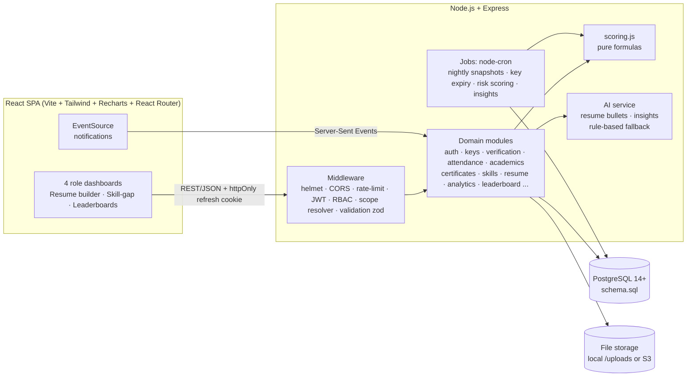
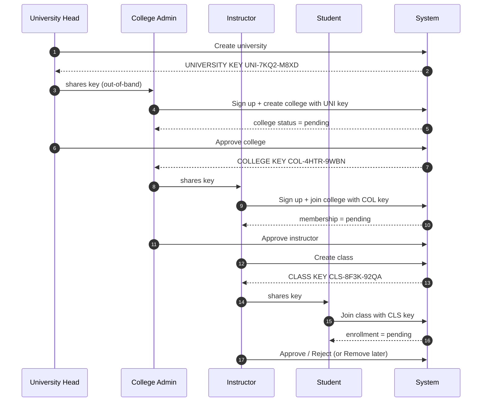
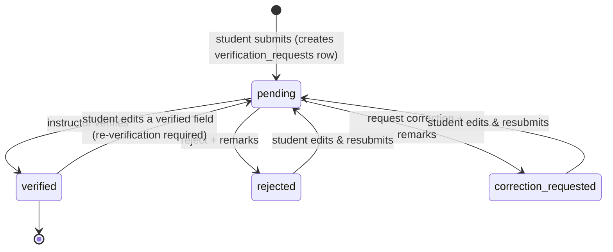

# SIMS — Architecture (Phase 1)

Hierarchy: **University → College → Class → Student**.
Data flows **up** (student → class → college → university). Verification flows **down** (instructor verifies students; college approves instructors; university approves colleges).

## 1. Design principles

1. **Verified-only analytics.** Every student-submitted record carries `verification_status`. Leaderboards, analytics, skill-gap (leaderboard variant), placement readiness and the resume read `verified` rows only.
2. **Scope is derived from the database, never trusted from the client.** The JWT carries `userId` + `role`; the scope (class / college / university) is resolved server-side on each request (§4).
3. **One scoring engine.** All formulas live in `backend/src/services/scoring.js` (pure functions, unit-tested). Dashboards at every level call the same code.
4. **Keys grant *eligibility to request*, not access.** A key only creates a pending membership that a human one level up approves (§5).
5. **Everything auditable.** State changes (verify, remove, key rotate, import, weight change) write to `audit_logs`.

## 2. System architecture



### Technology decisions

| Concern | Choice | Why |
|---|---|---|
| Database | **PostgreSQL** | Strong relational integrity for a strict hierarchy; partial unique indexes enforce rules like "one active key per class" and "one live class per student"; jsonb for flexible snapshots. |
| Auth | JWT access token (15 min, memory) + rotating refresh token (httpOnly, SameSite cookie, hashed in DB) | Short-lived access limits blast radius; refresh-reuse detection revokes the token family. |
| Passwords | argon2id (bcrypt acceptable) | Never stored in plaintext; reset via single-use hashed token. |
| Validation | zod schemas per route | Shared shapes, typed errors. |
| Real-time | **Server-Sent Events** | One-way server→client push is all we need; simpler than WebSockets, works through proxies. Notification rows are persisted, SSE just nudges the client. |
| PDF | Client: `@react-pdf/renderer` for resume; Server: `pdfkit`/Puppeteer for reports | Resume stays WYSIWYG with live preview; heavy reports render server-side. |
| Excel/CSV | `exceljs` (export), `csv-parse` / `xlsx` (import) | Import runs as an `import_jobs` row with a per-row error report. |
| Charts | Recharts (radar, line, bar, heatmap via custom grid) | |
| AI | Claude API behind `ai` module, with deterministic rule-based fallback | Resume-bullet rewriting + insight phrasing; analytics numbers themselves are always computed, never generated. |
| Aggregation | Nightly `metric_snapshots` + incremental refresh on verification events | Dashboards read cached numbers; trends come from historical snapshots. |

## 3. Roles & permission matrix

| Capability | Student | Instructor | College Admin | University Head |
|---|:-:|:-:|:-:|:-:|
| Edit own profile / submit marks claims, certificates, projects | ✅ | | | |
| View own data | ✅ | | | |
| Verify / reject / request correction | | ✅ (own class) | | |
| Enter attendance & marks (manual/CSV) | | ✅ (own class) | | |
| Approve / remove students | | ✅ (own class) | | |
| Publish activities, class announcements | | ✅ (own class) | | |
| Class analytics + class leaderboard | | ✅ | | |
| Approve / remove instructors | | | ✅ (own college) | |
| College analytics, department scores, college leaderboard | | | ✅ | |
| College-wide announcements, accreditation export | | | ✅ | |
| Approve / suspend colleges, rotate university key | | | | ✅ |
| Cross-college analytics, college leaderboard | | | | ✅ |
| Student-level PII (marks, certificates) | own | own class | **aggregates only** (+ names on leaderboard) | **aggregates only** |

## 4. Data scoping (privacy enforcement)

Middleware `resolveScope` loads, per request:

| Role | Source of scope | Resulting filter on every query |
|---|---|---|
| student | `v_student_scope` (approved enrollment) | `student_id = :me` |
| instructor | `classes WHERE instructor_id = :me` (+ approved `college_instructors`) | `class_id = :myClass` |
| college_admin | `colleges WHERE admin_user_id = :me` | `college_id = :myCollege` |
| university_head | `universities WHERE head_user_id = :me` | `university_id = :myUniversity` |

Rules:
- Route handlers receive `req.scope = { role, userId, universityId, collegeId, classId (student), classIds (instructor), status }` (implemented in `backend/src/middleware/scope.js`). Repository functions **require** the scope argument; there is no "unscoped" query helper.
- URL ids are *validated against scope* (`GET /classes/:id/...` returns 404 if `:id ≠ scope.classId`) — 404, not 403, to avoid leaking existence.
- College/University endpoints return aggregates (`avg`, `count`, rankings). Student-level rows are only exposed on leaderboards (name, roll, score) — never marks/certificates.
- Defence in depth (optional, Phase 7): PostgreSQL Row-Level Security using `SET LOCAL app.user_id` per transaction.

## 5. Unique key system



**Format.** `PFX-XXXX-XXXX` where `PFX ∈ {UNI, COL, CLS}` and the 8 characters come from a 32-symbol alphabet without ambiguous glyphs (`A-HJ-NP-Z2-9`), drawn with `crypto.randomInt` (never `Math.random`). 8 chars × 5 bits = **40 bits**; the DB enforces the format with a `CHECK`.

**Why 40 bits is enough** — a key alone grants nothing: the join creates a *pending* membership that a human approves, and:
- joins are rate-limited (5 requests / 10 min per IP + account) **and** guarded by a persistent DB-backed lockout: `KEY_MAX_FAILED_ATTEMPTS` (default 10) failed guesses from one IP *or* one account within 15 minutes → HTTP 429 even for a valid key;
- the error for unknown / revoked / expired / used-up / inactive-organisation keys is byte-identical, so the API is not a guessing oracle;
- every failed attempt is logged in `key_usage_logs` (with IP) and repeated misses raise an audit alert;
- keys can expire, have `max_uses`, and be revoked.

**Lifecycle** (`access_keys.status`): `active → rotated` (regenerate; old key stops working, `replaced_by` links to the new one) · `active → revoked` (manual) · `active → expired` (`expires_at` passed; nightly job + checked on use). A partial unique index guarantees **at most one active key per university/college/class**. Regenerating a class key does **not** remove existing students.

**Removal.** Instructor removal sets `class_enrollments.status = 'removed'` (history kept; data hidden from class analytics, student sees "removed" and can no longer submit). Student can request to join another class afterwards (partial unique index allows only one live enrollment).

## 6. Verification workflow



- Instructor-entered **attendance and marks** are inserted already `verified` (the instructor is the authority); **student claims** (e.g. "I was present on 12 Mar") start `pending`.
- Student edits to a verified record move it back to `pending` — verified status is never silently inherited by changed data.
- On `verified`: entity row + `verification_requests` row updated in one transaction → `audit_logs` entry → `notifications` row → SSE push → recompute `semester_results` / certificate `verification_code` (QR) / metric snapshots as relevant.

## 7. Data flow & aggregation

```
Student record (verified) ─▶ student metrics ─▶ class metrics ─▶ department ─▶ college ─▶ university
                              (snapshot)         (snapshot)      (snapshot)   (snapshot)  (snapshot)
```

- **Incremental:** verification events mark the student's metrics dirty → recomputed in a background queue.
- **Nightly:** full `metric_snapshots` run for all levels (keeps trend history), dropout-risk scoring, AI insight generation (e.g. compares this month vs last for each department), key-expiry sweep.
- Scores are **never stored on the entity tables** — they live in `metric_snapshots` so history and trend charts come for free.

## 8. Security checklist

- Helmet, CORS allow-list, request-size limits, global + auth-specific rate limiting.
- Uploads: MIME sniffing (magic bytes) not just extension, 5 MB cap, random filenames, SHA-256 stored (blocks duplicate/re-submitted certificates), served via authenticated route or signed URL.
- **Certificate QR:** `GET /verify/:code` (public, unauthenticated) returns only `{holder, title, issuer, verifiedBy, verifiedAt, valid}` — no contact info.
- Parameterised SQL only (`pg` placeholders); zod validation on every body/query.
- Account enumeration safe: login/forgot-password responses are identical for unknown emails.
- Secrets via env (`.env.example`); no secrets in the repo.

## 9. Folder structure

```
sims/
├── README.md
├── docs/
│   ├── ARCHITECTURE.md        ← this file
│   ├── ER_DIAGRAM.md          ← tables & relationships
│   ├── API.md                 ← endpoint list
│   └── SCORING.md             ← every formula
├── database/
│   ├── schema.sql             ← full PostgreSQL schema (Phase 1)
│   ├── migrations/            ← versioned migrations (Phase 2+)
│   └── seeds/                 ← demo data (Phase 7)
├── backend/
│   ├── package.json
│   ├── .env.example           (Phase 2)
│   ├── uploads/               ← local certificate storage (git-ignored)
│   ├── tests/
│   │   └── scoring.test.js
│   └── src/
│       ├── server.js / app.js          (Phase 2)
│       ├── config/                     env, constants
│       ├── db/                         pg pool, transaction helper
│       ├── middleware/                 auth, rbac, resolveScope, rateLimit, validate, upload, error
│       ├── utils/                      keygen, tokens, csv, pdf
│       ├── jobs/                       nightlySnapshots, keyExpiry, riskScoring, insights
│       ├── routes/                     central router that mounts modules
│       ├── services/
│       │   └── scoring.js              ← pure formulas (Phase 1)
│       └── modules/                    each = routes + controller + service + repo + schema
│           ├── auth/        keys/       users/       students/
│           ├── attendance/  academics/  certificates/ projects/
│           ├── skills/      resume/     classes/     verification/
│           ├── activities/  announcements/ leaderboard/ analytics/
│           ├── colleges/    universities/ notifications/ audit/
│           └── imports/     reports/    ai/
└── frontend/
    └── src/
        ├── app/            router, providers, route guards by role
        ├── layouts/        DashboardLayout (sidebar + topbar + theme toggle)
        ├── components/     Charts, DataTable, StatusBadge, KeyCard, Leaderboard, ...
        ├── hooks/          useAuth, useApi, useNotifications (SSE)
        ├── lib/            api client (axios + refresh interceptor), formatters
        ├── store/          auth + theme state
        └── pages/
            ├── auth/       login, signup (per role), forgot/reset password
            ├── student/    profile, attendance, academics, certificates, resume, skill-gap ...
            ├── class/      requests, verification center, analytics, leaderboard, activities
            ├── college/    departments, analytics, leaderboard, instructors
            ├── university/ colleges, analytics, leaderboard
            └── shared/     announcements, notifications, audit log
```

## 10. Decisions made on ambiguous points (tell me if you want any changed)

1. **Skill-gap & "verified only".** Your spec says manual skill entries count, but also that only verified data counts in analytics. Resolution: the student's *personal* analyzer shows both (self-declared counted at full level, flagged), while the **leaderboard / class / college** skill component uses the **verified-only gap** (`skill_gap_snapshots.verified_gap_percent`). Manual skills can be verified by the instructor like anything else.
2. **College approval.** Added a step where the University Head approves a new college (needed for "approve or suspend colleges"). Likewise College Admin approves instructors.
3. **One college per instructor, one live class per student** (enforced by partial unique indexes). An instructor may own multiple classes in that college.
4. **Departments** are first-class (the college dashboard needs them); a class belongs to one department.
5. **Instructor-entered attendance/marks are auto-verified.**
6. **Database:** PostgreSQL (not MongoDB) — the hierarchy and "at most one active X" constraints map naturally to relational constraints.
7. **Dropout risk** is a transparent weighted heuristic in v1 (explainable factors stored in `dropout_risk_scores.factors`); swap for ML later without schema change.

## 11. Phase roadmap

| Phase | Deliverable |
|---|---|
| **1 (this)** | Architecture, folder structure, schema, ER, API list, scoring formulas (+ tested scoring engine) |
| 2 | Express app, auth (JWT/refresh/reset), key generation & join flow, RBAC + scope middleware |
| 3 | Student dashboard incl. resume builder & skill-gap analyzer |
| 4 | Class dashboard: verification workflow, imports, analytics, leaderboard |
| 5 | College dashboard |
| 6 | University dashboard |
| 7 | Seed/demo data, testing steps, deployment guide |
