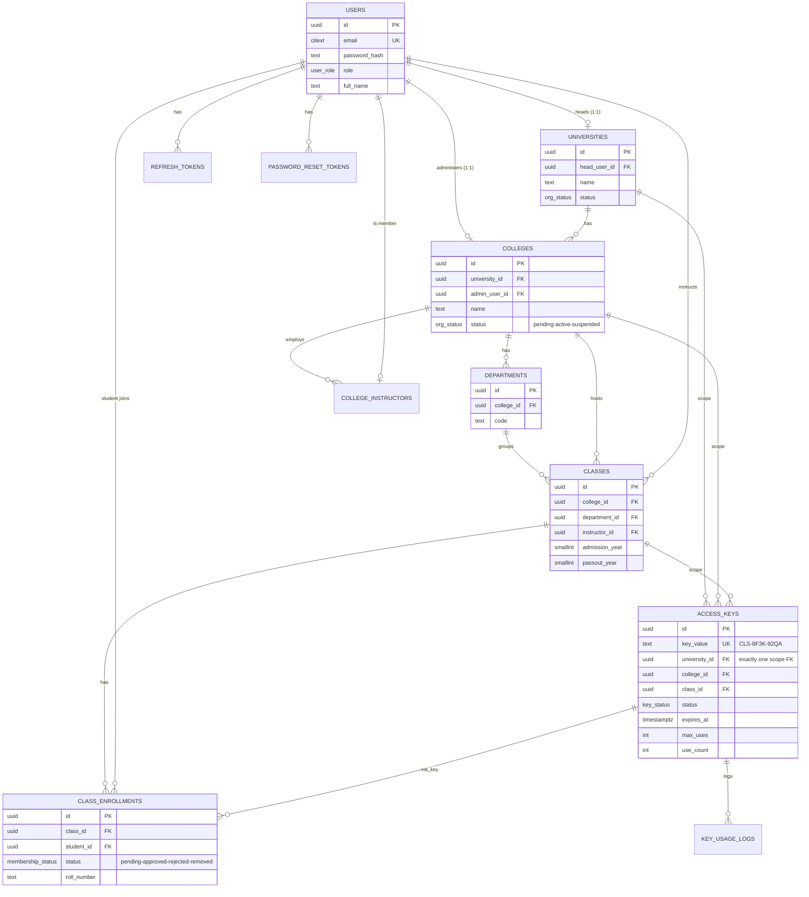
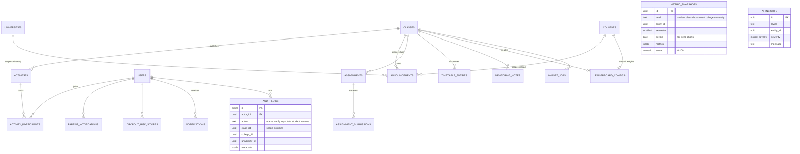

# SIMS — ER Diagram

Source of truth is [`database/schema.sql`](../database/schema.sql). The diagram is split in three so it stays readable (render with any Mermaid viewer, e.g. GitHub or VS Code).

## A. Identity, hierarchy & keys

## B. Student data (all verification-gated)

```mermaid
erDiagram
  USERS ||--o| STUDENT_PROFILES : has
  CLASSES ||--o{ SUBJECTS : offers
  USERS ||--o{ ATTENDANCE_RECORDS : has
  SUBJECTS ||--o{ ATTENDANCE_RECORDS : for
  USERS ||--o{ MARKS : has
  SUBJECTS ||--o{ MARKS : for
  USERS ||--o{ SEMESTER_RESULTS : "cached SGPA/CGPA"
  USERS ||--o{ CERTIFICATES : uploads
  USERS ||--o{ PORTFOLIO_ITEMS : "projects / internships / publications"
  USERS ||--o{ VERIFICATION_REQUESTS : submits
  CLASSES ||--o{ VERIFICATION_REQUESTS : "queue"
  SKILLS ||--o{ STUDENT_SKILLS : ""
  USERS ||--o{ STUDENT_SKILLS : has
  CERTIFICATES ||--o{ STUDENT_SKILLS : "evidence"
  PORTFOLIO_ITEMS ||--o{ STUDENT_SKILLS : "evidence"
  CAREER_ROLES ||--o{ ROLE_SKILLS : requires
  SKILLS ||--o{ ROLE_SKILLS : ""
  SKILLS ||--o{ LEARNING_RESOURCES : "taught by"
  USERS ||--o| STUDENT_TARGET_ROLES : targets
  CAREER_ROLES ||--o{ STUDENT_TARGET_ROLES : ""
  USERS ||--o{ SKILL_GAP_SNAPSHOTS : "progress over time"
  USERS ||--o{ RESUMES : builds
  USERS ||--o{ STUDENT_GOALS : sets
  STUDENT_GOALS ||--o{ STUDY_PLAN_ITEMS : ""
  USERS ||--o{ STUDENT_BADGES : earns
  BADGES ||--o{ STUDENT_BADGES : ""

  VERIFICATION_REQUESTS {
    uuid id PK
    uuid class_id FK
    uuid student_id FK
    verifiable_entity entity_type "profile marks attendance certificate project skill"
    uuid entity_id "polymorphic"
    verification_status status
    text reviewer_remarks
  }
  MARKS {
    uuid id PK
    uuid student_id FK
    uuid subject_id FK
    smallint attempt "gt 1 means backlog retry"
    numeric internal_obtained
    numeric external_obtained
    numeric grade_points
    verification_status verification_status
  }
  CERTIFICATES {
    uuid id PK
    uuid student_id FK
    certificate_category category
    text file_sha256 "duplicate and tamper check"
    text verification_code UK "QR payload"
    verification_status verification_status
  }
  STUDENT_SKILLS {
    uuid id PK
    smallint proficiency "1-5"
    skill_source source "manual certificate project"
  }
  ROLE_SKILLS {
    smallint required_level "1-5"
    numeric weight
  }
```

## C. Class life, analytics & cross-cutting

## D. Notes

- **Scope derivation views:** `v_student_scope` (student → class → department → college → university), `v_attendance_by_subject`, `v_attendance_overall` (verified rows only).
- **Integrity enforced by the DB (not just app code):**
  - exactly one scope FK per `access_keys` / `announcements` / `leaderboard_configs` row (`CHECK`);
  - ≤ 1 active key per university / college / class (partial unique index);
  - a student has ≤ 1 live (pending/approved) enrollment; an instructor belongs to ≤ 1 live college;
  - leaderboard weights must sum to 100;
  - duplicate certificate file per student rejected (`UNIQUE(student_id, file_sha256)`);
  - only one open verification request per entity.
- **No scores on entity tables** — all composites live in `metric_snapshots`.
